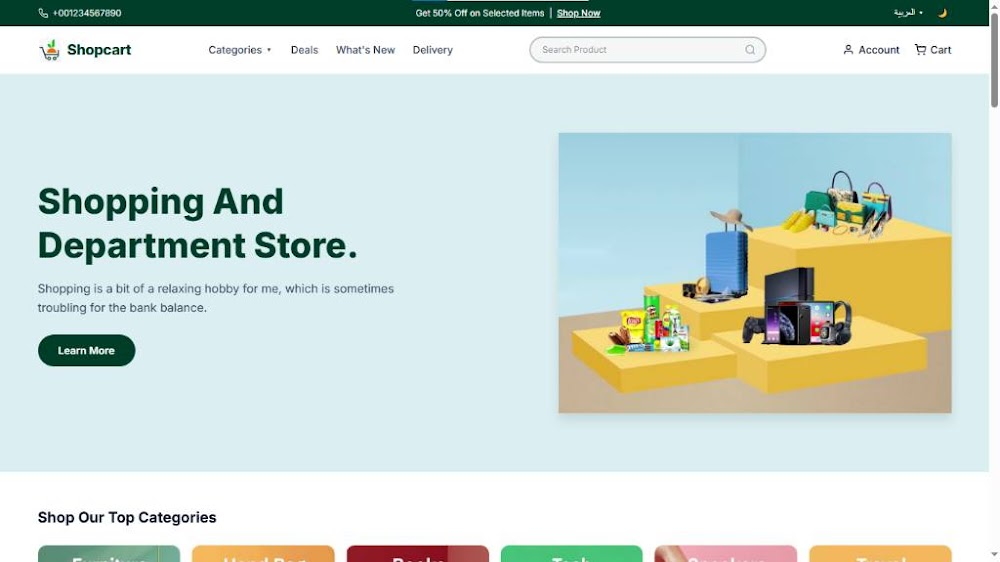

# 🛒 Shopcart — Modern E-Commerce Web Application

A full-featured, responsive e-commerce storefront upgraded and rebuilt with **Next.js (App Router)**, **React 19**, **TypeScript**, and **Tailwind CSS**.

🔗 **Live Demo:** [shopcart-red-three.vercel.app](https://vercel.app)



---

## ✨ Key Features

- **Dynamic Product Catalog:** Filter products by category (*Tech, Furniture, Hand Bag, Books, Sneakers, Travel*), price range, customer rating, color swatches, material, and special offers.
- **Interactive Product Details:** Dynamic routing (`/product/[id]`) with color variant image switching (e.g., AirPods Max), quantity selector, and detailed technical specifications.
- **Shopping Cart & Checkout Flow:** Real-time cart state management using React Context API, item quantity updates, and a complete checkout experience.
- **Bilingual Support (EN / AR):** Seamless switching between English and Arabic with full RTL/LTR layout adaptation.
- **Dark & Light Mode:** Persistent theme toggle for comfortable browsing in any lighting condition.
- **Responsive Design:** Mobile-first UI crafted with Tailwind CSS for seamless viewing across mobile, tablet, and desktop screens.

---

## 🛠️ Tech Stack

- **Framework:** Next.js (App Router)
- **Library:** React 19
- **Language:** TypeScript
- **Styling:** Tailwind CSS
- **State Management:** React Context API
- **Deployment:** Vercel

---

## 📂 Project Structure

```text
├── public/
│   └── img/               # Product, category, and banner assets
├── src/
│   ├── app/               # Next.js App Router pages (Home, Product Details, Checkout)
│   ├── components/        # Reusable UI components (Navbar, Footer, ProductCard, CartDrawer)
│   ├── context/           # Global state management (Cart, Language, Theme)
│   ├── data/              # Structured product catalog and categories
│   └── types/             # TypeScript interfaces and type definitions
└── package.json
```

---

## 🚀 Getting Started Locally

1. **Clone the repository:**
   git clone https://github.com/AhmadBakhit2000/shopcart.git


2. **Install dependencies:**
   ```bash
   npm install
   ```

3. **Run the development server:**
   ```bash
   npm run dev
   ```
   Open [http://localhost:3000](http://localhost:3000) in your browser.

---

## 👨‍💻 Author

**AhmadAlmubarak Bakhit**  
- GitHub: [@AhmadBakhit2000](https://github.com)
